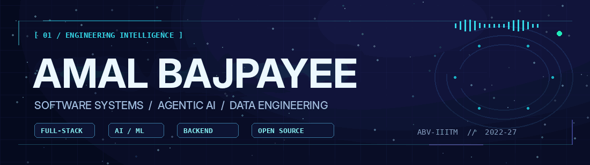

<!--
  AMAL BAJPAYEE / THE CINEMATIC ENGINEERING PROFILE
  GitHub-profile-compatible HTML + Markdown. No scripts required.
  Custom animated banner: assets/amal-cinematic-banner.gif
  Snake animation: .github/workflows/snake.yml -> output branch
-->

<div align="center">

<!-- CHAPTER 00 : THE OPENING SHOT -->


<br /><br />


<br />

<a href="https://abajpayee33.vercel.app/"></a>
<a href="https://www.linkedin.com/in/abajpai09/"></a>
<a href="mailto:amalbajpayee09@gmail.com"></a>
<a href="https://github.com/AmalBajpayee09?tab=repositories"></a>

<br /><br />


<br /><br />

<sup>◈ &nbsp; ENGINEER BY TRAINING &nbsp;·&nbsp; BUILDER BY INSTINCT &nbsp;·&nbsp; ALWAYS LEARNING &nbsp; ◈</sup>

</div>

---

## 🎬 `ACT I // INITIALIZING...`

```text
┌──────────────────────────────────────────────────────────────────────┐
│  SUBJECT    AMAL BAJPAYEE                                          │
│  ORIGIN     ABV-IIITM GWALIOR  ·  INTEGRATED B.TECH + M.TECH (IT) │
│  DISCIPLINE SOFTWARE ENGINEERING  /  AI  /  DATA SYSTEMS           │
│  MISSION    MAKE COMPLEX TECHNOLOGY USEFUL IN THE REAL WORLD       │
│  CURRENT    BUILDING  •  TESTING  •  LEARNING  •  ITERATING         │
└──────────────────────────────────────────────────────────────────────┘
```

I'm **Amal Bajpayee**, an Integrated B.Tech. + M.Tech. Information Technology student at **ABV-IIITM Gwalior (2022–2027)**. I build across the stack—from **secure APIs, databases, full-stack interfaces and distributed workflows** to **AI agents, machine learning, computer vision and data pipelines**.

At **Lord-Tech Datus Solutions**, I contributed to the **TIIC-funded NirmalGwalior Smart City initiative**, developing computer-vision processing and integrating AI outputs with **FastAPI, PostgreSQL/PostGIS and React**. My other work spans data analysis, validation and interactive Power BI reporting.

> **My philosophy:** Great engineering isn't just a clever demo. It's a useful system that people can understand, operate and improve.

<table>
  <tr>
    <td width="33%" valign="top"><strong>⚙️ THE ENGINEER</strong><br /><br />Backend APIs · distributed systems · secure workflows · reliability</td>
    <td width="33%" valign="top"><strong>🧠 THE AI BUILDER</strong><br /><br />LLMs · RAG · agents · machine learning · computer vision</td>
    <td width="33%" valign="top"><strong>📊 THE DATA THINKER</strong><br /><br />SQL · ETL · validation · analytics · visualization</td>
  </tr>
</table>

---

## 🚀 `ACT II // THE SYSTEMS I'VE BUILT`

<div align="center">
  
</div>

A cross-domain selection of engineering projects. Descriptions reflect project work I've documented; links to individual repositories can be added as they become public.

| Project | Engineering focus | Stack |
|:--|:--|:--|
| **🎙️ BharatVoice AI** — Multilingual Voice Platform | Real-time Hindi, English and Hinglish speech workflows across browser and phone; LLM-powered responses with retrieval. | `Python` `FastAPI` `WebSockets` `Deepgram` `Groq` `ChromaDB` |
| **🧠 AI Hiring Copilot** — Agentic Recruitment | Resume parsing, candidate/job matching, skill-gap analysis and interview generation with retrieval-aware agent workflows. | `LangGraph` `RAG` `FAISS` `FastAPI` `PostgreSQL` `Redis` |
| **📈 ProspectIQ** — Predictive Intelligence | ML-based prospect scoring, feature engineering, explainability and agent-assisted intelligence workflows. | `Scikit-learn` `XGBoost` `SHAP` `LangGraph` `MLflow` |
| **🏢 LedgerFlow** — Enterprise Data Operations | Finance operations, role-based controls, audit trails, reconciliation and data quality workflows. | `React` `FastAPI` `SQL` `Databricks` `PySpark` |
| **🚨 CloudOps AI** — Incident Management | Real-time incident dashboards, secure APIs and AI-assisted investigations with human approval. | `React` `Node.js` `Redis` `Socket.IO` `Docker` |
| **⚡ TransactX** — Distributed Transactions | Event-driven services, transactional outbox, idempotency, fault tolerance and observability. | `Java` `Spring Boot` `Kafka` `PostgreSQL` `Grafana` |

<div align="center">
  <a href="https://github.com/AmalBajpayee09?tab=repositories"></a>
</div>

---

## 🛠️ `ACT III // TECHNOLOGY ARSENAL`

<div align="center">

**LANGUAGES / FOUNDATIONS**


<br /><br />

**FULL-STACK / BACKEND / DATABASES**


<br /><br />

**AI / ML / DATA INTELLIGENCE**


<br />


<br /><br />

**CLOUD / DEVOPS / ENGINEERING TOOLS**


</div>

---

## 🏙️ `ACT IV // IMPACT BEYOND THE SCREEN`

<table>
<tr>
<td width="50%" valign="top">

**🌆 NirmalGwalior Smart City**

Contributed to a **TIIC-funded initiative** involving YOLOv8, OpenCV, MiDaS, waste-monitoring workflows and location-aware integration through FastAPI, PostGIS and React.

</td>
<td width="50%" valign="top">

**📊 Data Analytics & Reporting**

Cleaned and validated business/research datasets with Python and Pandas, performed exploratory analysis and produced **Power BI dashboards** for insights and KPI tracking.

</td>
</tr>
</table>

**Currently exploring:** `System Design` · `Distributed Systems` · `AI Agent Reliability` · `LLM Evaluation` · `MLOps` · `Cloud-Native Architecture`

---

## 🔥 `ACT V // THE CONSISTENCY ENGINE`

<div align="center">

**BUILDING IS A HABIT. NOT A ONE-TIME EVENT.**

<br />

<!-- Dynamic contribution and streak cards; no manually frozen numbers -->


<br />


<br /><br />

<a href="https://github.com/AmalBajpayee09"></a>

<br />

<sub>The native green GitHub contribution calendar stays on my profile. These are additional dynamic views, not replacements.</sub>

</div>

### 🐍 `THE CONTRIBUTION SNAKE // ALWAYS MOVING`

<div align="center">

<picture>
  <source media="(prefers-color-scheme: dark)" srcset="https://raw.githubusercontent.com/AmalBajpayee09/AmalBajpayee09/output/github-contribution-grid-snake-dark.svg" />
  <source media="(prefers-color-scheme: light)" srcset="https://raw.githubusercontent.com/AmalBajpayee09/AmalBajpayee09/output/github-contribution-grid-snake.svg" />
  
</picture>

<sub>Generated daily by GitHub Actions after the first successful workflow run.</sub>

</div>

---

## 🏆 `ACT VI // MILESTONES UNLOCKED`

- **INR 2,00,000 in TIIC innovation funding** associated with the NirmalGwalior Smart City project at ABV-IIITM Gwalior.
- **Core Technical Member — AI & Smart City**, Lord-Tech Datus Solutions (May–July 2026).
- **Data Analytics Intern**, Lord-Tech Datus Solutions (June–September 2025).
- Completed the **C-DAC Noida Ethical Hacking & Penetration Testing** program and virtual internship under the Cyber Gyan Project.

---

## 🌌 `THE NEXT CHAPTER // LET'S BUILD`

<div align="center">

**BIG IDEAS DESERVE SYSTEMS THAT ACTUALLY WORK.**

I'm interested in ambitious projects at the intersection of **software engineering, intelligent systems, AI, ML and data**. If you're building something meaningful, let's connect.

<br /><br />

<a href="mailto:amalbajpayee09@gmail.com"></a>
<a href="https://www.linkedin.com/in/abajpai09/"></a>
<a href="https://abajpayee33.vercel.app/"></a>

<br /><br />

**`BUILD THOUGHTFULLY // TEST RELENTLESSLY // KEEP MOVING FORWARD`**

<br />


<sub>Directed, designed and built with curiosity, persistence and a builder's mindset.</sub>

</div>
