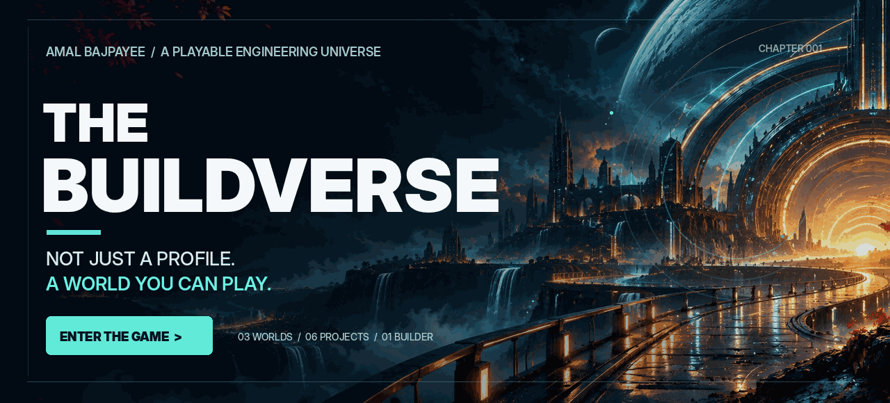
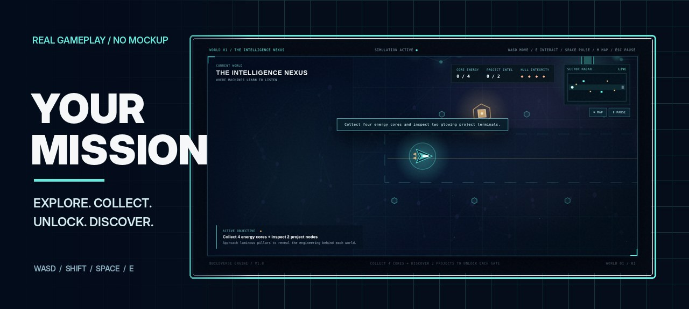
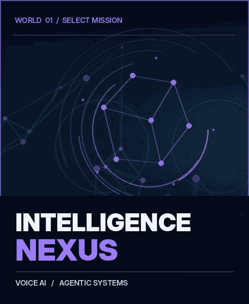
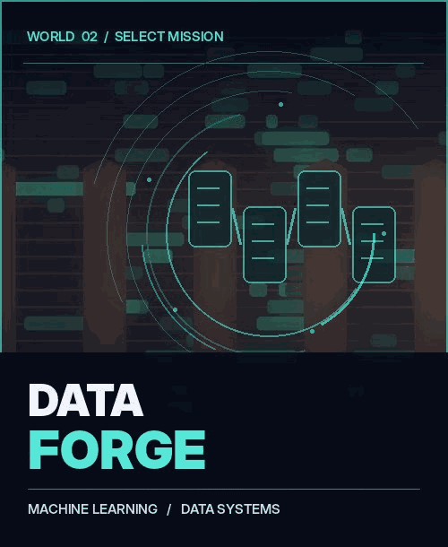
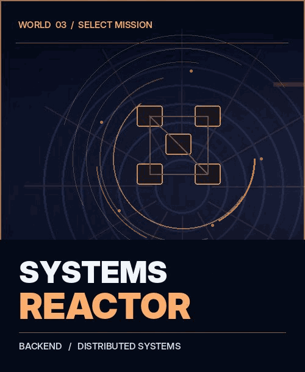
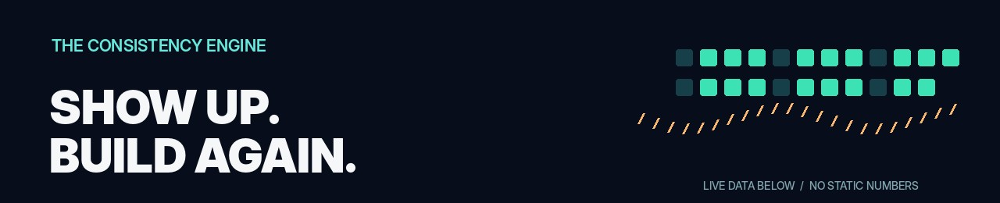
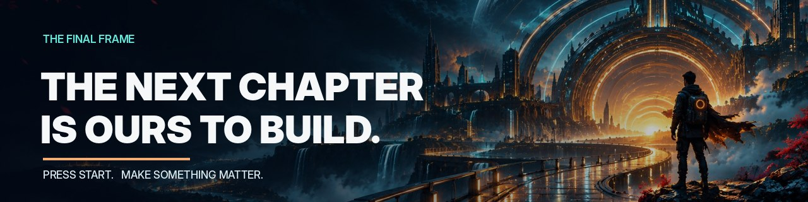

<!--
  THE BUILDVERSE / GITHUB PROFILE — CINEMATIC GAME LOBBY
  Motion is supplied by local animated GIF files, not unsupported README scripts.
  The actual playable game lives in docs/ and must be enabled under GitHub Pages.
  Don't delete your existing .github workflows or contribution history.
-->

<a href="https://amalbajpayee09.github.io/AmalBajpayee09/" title="Launch the playable Buildverse portfolio">
  <picture>
    <source media="(prefers-reduced-motion: reduce)" srcset="assets/00-enter-the-buildverse.jpg" />
    
  </picture>
</a>

 

AN INTERACTIVE ENGINEERING UNIVERSE · THREE WORLDS · SIX PROJECTS · ONE BUILDER

  

<strong>AMAL BAJPAYEE</strong> &nbsp; / &nbsp; Software Engineering · Agentic AI · Machine Learning · Data Systems

  

<a href="https://amalbajpayee09.github.io/AmalBajpayee09/"><strong>▶ ENTER THE GAME</strong></a>
&nbsp; · &nbsp;
<a href="https://abajpayee33.vercel.app/"><strong>EXPLORE PORTFOLIO</strong></a>
&nbsp; · &nbsp;
<a href="https://github.com/AmalBajpayee09?tab=repositories"><strong>VIEW SOURCE</strong></a>
&nbsp; · &nbsp;
<a href="mailto:amalbajpayee09@gmail.com"><strong>CONTACT</strong></a>

  

PLAYABLE IN A BROWSER &nbsp; / &nbsp; NO SIGN-IN &nbsp; / &nbsp; DESKTOP + MOBILE CONTROLS

---

## 01 / The premise

**Most portfolios ask you to scroll. Mine asks you to explore.**

I'm **Amal Bajpayee**, an Integrated B.Tech. + M.Tech. Information Technology student at **ABV-IIITM Gwalior (2022–2027)**. I enjoy building the parts that make a product real: **interfaces people can use, APIs that hold up, data that can be trusted, and AI systems that do something useful**.

I turned my portfolio into **The Buildverse**, a playable browser adventure. Navigate three worlds, collect energy cores, avoid sentries, and discover the engineering behind six selected projects. If you're here to hire rather than play, **Explore Without Playing** opens the project dossiers immediately.

ACTUAL GAMEPLAY · MOVE WITH WASD/ARROWS · BOOST WITH SHIFT · PULSE WITH SPACE · INTERACT WITH E

---

## 02 / Choose your world

<a href="#intelligence-nexus"><picture><source media="(prefers-reduced-motion: reduce)" srcset="assets/01-world-intelligence.jpg" /></picture></a>
<a href="#data-forge"><picture><source media="(prefers-reduced-motion: reduce)" srcset="assets/02-world-data.jpg" /></picture></a>
<a href="#systems-reactor"><picture><source media="(prefers-reduced-motion: reduce)" srcset="assets/03-world-systems.jpg" /></picture></a>

 

CLICK A WORLD TO OPEN ITS PROJECT BRIEFING · OR <a href="https://amalbajpayee09.github.io/AmalBajpayee09/">PLAY THROUGH ALL THREE</a>

### Intelligence Nexus

**Build intelligence that can listen, retrieve, reason, and assist.**

<strong>OPEN INTELLIGENCE DOSSIER</strong> · BharatVoice AI + AI Hiring Copilot

**BharatVoice AI — Multilingual Voice Automation**  
Real-time Hindi, English and Hinglish voice workflows across browser and phone interactions. Combines FastAPI, WebSockets, Deepgram speech recognition, Groq language models, Piper synthesis, and retrieval over business knowledge.

**AI Hiring Copilot — Agentic Recruitment**  
LLM- and RAG-assisted resume parsing, candidate-to-job matching, skill-gap analysis and interview question generation with LangGraph, FAISS, PostgreSQL, Redis and FastAPI.

**What I explored:** speech pipelines · asynchronous APIs · semantic search · agent orchestration · structured data.

### Data Forge

**Turn raw information into trustworthy decisions.**

<strong>OPEN DATA DOSSIER</strong> · ProspectIQ + LedgerFlow

**ProspectIQ — Predictive Intelligence**  
Predictive prospect-scoring workflows built around XGBoost, Random Forest, Logistic Regression, feature engineering, evaluation and SHAP explainability, with LangGraph/RAG-assisted intelligence.

**LedgerFlow — Enterprise Finance Data Operations**  
Full-stack finance operations using React, FastAPI, SQL, RBAC, audit logging and SharePoint document workflows, alongside Databricks/PySpark ETL for financial reconciliation and validation.

**What I explored:** model evaluation · explainability · data quality · ETL · secure operational tools.

### Systems Reactor

**Design for the failures, not just the happy path.**

<strong>OPEN SYSTEMS DOSSIER</strong> · TransactX + CloudOps AI

**TransactX — Distributed Transaction Processing**  
Java/Spring Boot and Kafka services for transaction workflows, exploring transactional outbox, idempotency, distributed locking, circuit breakers and observability.

**CloudOps AI — Incident Management & AI Investigation**  
React, Node.js, Redis and Socket.IO-powered incident workflows, with authentication, operational dashboards and an LLM-assisted investigator that recommends actions with human approval.

**What I explored:** reliability patterns · messaging · API security · real-time interfaces · monitoring.

**Six projects. Different disciplines. One engineering mindset.**

<a href="https://github.com/AmalBajpayee09?tab=repositories">Browse public repositories</a> &nbsp; / &nbsp; <a href="https://abajpayee33.vercel.app/">View full portfolio</a>

---

## 03 / The person behind the screen

My interest in engineering is grounded in work beyond personal projects. As a **Core Technical Member — AI & Smart City** at **Lord-Tech Datus Solutions**, I contributed to the **TIIC-funded NirmalGwalior initiative** (₹2,00,000 in innovation funding). My work included computer-vision processing with **Python, OpenCV, YOLOv8 and MiDaS**, plus connecting outputs to **FastAPI, PostgreSQL/PostGIS and React** for location-aware monitoring.

Earlier, as a **Data Analytics Intern**, I worked on cleaning, validation and exploratory analysis of business/research datasets using **Python and Pandas**, with interactive **Power BI** reporting.

**The parts of engineering I keep coming back to:** systems design, debugging, reliable APIs, useful AI, data quality, testing, and translating difficult problems into working software.

### The toolkit — intentionally curated

  

<strong>AI & Data</strong> &nbsp; LLMs · RAG · LangGraph · FAISS · Scikit-learn · XGBoost · OpenCV · Pandas · PySpark

 

<strong>Systems & Quality</strong> &nbsp; REST APIs · SQL · Kafka · Docker · GitHub Actions · CI/CD · Observability

---

## 04 / The consistency engine

  

 

  

<picture>
  <source media="(prefers-color-scheme: dark)" srcset="https://raw.githubusercontent.com/AmalBajpayee09/AmalBajpayee09/output/github-contribution-grid-snake-dark.svg" />
  <source media="(prefers-color-scheme: light)" srcset="https://raw.githubusercontent.com/AmalBajpayee09/AmalBajpayee09/output/github-contribution-grid-snake.svg" />
  
</picture>

 

The native GitHub contribution calendar and contribution history are still on my profile. These are additional live views, not replacements. The snake requires its existing GitHub Actions workflow.

  

<a href="https://github.com/AmalBajpayee09?tab=overview"><strong>VIEW MY REAL CONTRIBUTION CALENDAR</strong></a>

---

## 05 / The next chapter

  

**Looking for someone who can move between backend systems, full-stack products, intelligent agents and data engineering?**

I enjoy ambitious problems, thoughtful teammates and building things that people can actually use.

 

<a href="https://amalbajpayee09.github.io/AmalBajpayee09/"><strong>PLAY THE BUILDVERSE</strong></a>
&nbsp; · &nbsp;
<a href="https://abajpayee33.vercel.app/"><strong>PORTFOLIO</strong></a>
&nbsp; · &nbsp;
<a href="https://www.linkedin.com/in/abajpai09/"><strong>LINKEDIN</strong></a>
&nbsp; · &nbsp;
<a href="mailto:amalbajpayee09@gmail.com"><strong>EMAIL</strong></a>

  

 

AN INTERACTIVE PORTFOLIO EXPERIMENT BY AMAL BAJPAYEE · MADE TO BE EXPLORED

