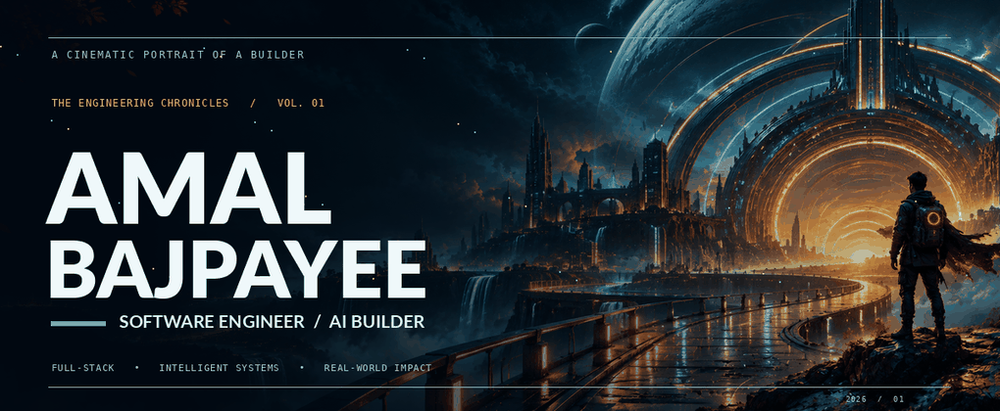
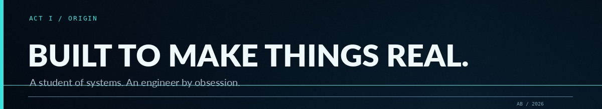
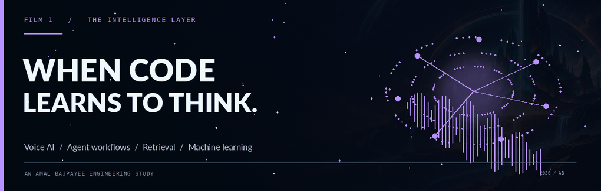
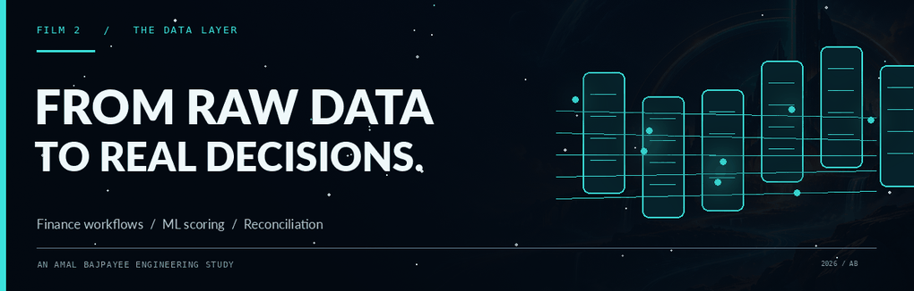
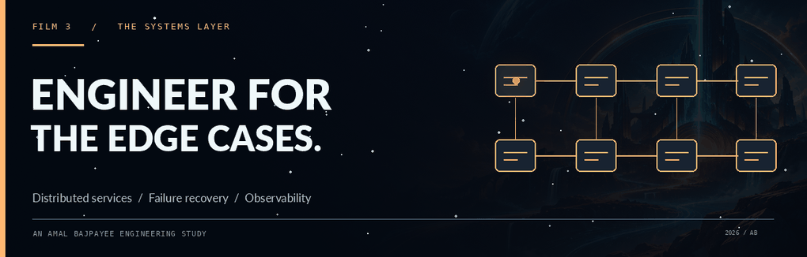
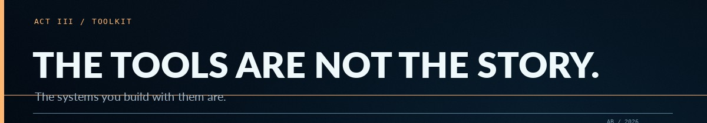
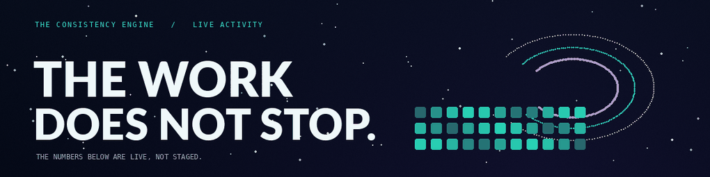
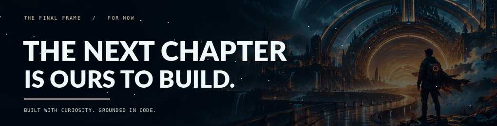

<!--
  AMAL BAJPAYEE — THE ENGINEERING CHRONICLES / CINEMATIC CUT V4
  Entire profile is GitHub-compatible Markdown + images/GIFs.
  No custom CSS, JavaScript, or third-party iframe embeds.
  Keep the /assets directory when you upload this README.
-->

<picture>
  <source media="(prefers-reduced-motion: reduce)" srcset="assets/01-opening-sequence-still.jpg" />
  
</picture>

 

**Building across software engineering, intelligent systems and data — one real problem at a time.**

ABV-IIITM Gwalior · Integrated B.Tech. + M.Tech. (IT) · Class of 2027 · India

  

<a href="https://abajpayee33.vercel.app/"><strong>EXPLORE THE PORTFOLIO</strong></a> &nbsp; / &nbsp;
<a href="https://github.com/AmalBajpayee09?tab=repositories"><strong>VIEW THE CODE</strong></a> &nbsp; / &nbsp;
<a href="https://www.linkedin.com/in/abajpai09/"><strong>LINKEDIN</strong></a> &nbsp; / &nbsp;
<a href="mailto:amalbajpayee09@gmail.com"><strong>CONTACT</strong></a>

 

<!-- SCENE ONE — ORIGIN -->

I’m **Amal Bajpayee**, an Integrated B.Tech. + M.Tech. Information Technology student at **ABV-IIITM Gwalior**. I build across the stack: **backend services, full-stack products, machine learning, agentic AI, data pipelines and distributed workflows**.

I care about what happens beyond a working demo: whether a system is **useful, understandable, secure, testable and resilient when things go wrong**.

My experience includes contributing to the **TIIC-funded NirmalGwalior Smart City initiative** at Lord-Tech Datus Solutions. I worked with **Python, OpenCV, YOLOv8 and MiDaS** for computer-vision processing, and helped integrate outputs through **FastAPI, PostgreSQL/PostGIS and React**. Earlier, I worked on data cleaning, validation, analysis and **Power BI** reporting.

> **The north star:** Build the thing. Understand its limits. Improve the system.

 

<!-- SCENE TWO — THE BUILDS -->

### THE WORLDS I'M BUILDING

Three disciplines · Six selected projects · More than one way to solve a hard problem

<picture>
  <source media="(prefers-reduced-motion: reduce)" srcset="assets/03-intelligence-still.jpg" />
  
</picture>

**BharatVoice AI** · *Multilingual voice automation*  
A real-time Hindi, English and Hinglish voice application combining **FastAPI, WebSockets, Deepgram speech recognition, Groq LLM responses, Piper speech synthesis and RAG** across web and telephony workflows.

**AI Hiring Copilot** · *Retrieval-aware recruitment agents*  
An AI-assisted platform for **resume parsing, candidate-to-role matching, skill-gap analysis and interview-question generation** using **LangGraph, FAISS, FastAPI, PostgreSQL and Redis**.

 

<picture>
  <source media="(prefers-reduced-motion: reduce)" srcset="assets/04-data-still.jpg" />
  
</picture>

**ProspectIQ** · *Predictive and explainable intelligence*  
Prospect-scoring workflows combining **XGBoost, Random Forest, Logistic Regression, feature engineering, model evaluation, SHAP explainability** and retrieval-aware AI tools.

**LedgerFlow** · *Enterprise finance operations*  
A **React + FastAPI** finance workflow platform featuring **RBAC, audit trails, SharePoint document integration** and **Databricks/PySpark** data validation and reconciliation pipelines.

 

<picture>
  <source media="(prefers-reduced-motion: reduce)" srcset="assets/05-systems-still.jpg" />
  
</picture>

**TransactX** · *Distributed transaction processing*  
A **Java/Spring Boot + Kafka** microservices system exploring **idempotency, transactional outbox, distributed locking, circuit breakers** and service observability.

**CloudOps AI** · *Incident operations and investigation*  
A full-stack incident-management platform using **React, Node.js, Redis, Socket.IO and JWT/RBAC**, including operational dashboards and **AI-assisted investigation with human approval**.

These are engineering project descriptions, not claims of production deployment. Source availability varies; browse the public repositories below.

[**EXPLORE PUBLIC REPOSITORIES**](https://github.com/AmalBajpayee09?tab=repositories) &nbsp; · &nbsp; [**VIEW THE FULL PORTFOLIO**](https://abajpayee33.vercel.app/)

 

<!-- SCENE THREE — TOOLKIT -->

**Engineering foundations** — `Python` `Java` `Go` `C++` `JavaScript` `TypeScript` `SQL` · DSA · OOP · system design

**Applications & APIs** — `FastAPI` `Spring Boot` `Node.js` `React` `Next.js` · REST APIs · authentication · authorization

**Intelligent systems** — `LangGraph` `LangChain` `RAG` `FAISS` `Scikit-learn` `XGBoost` `OpenCV` · LLM evaluation

**Data & infrastructure** — `PostgreSQL` `Redis` `Kafka` `PySpark` `Databricks` `Docker` `Kubernetes` `AWS` · CI/CD · observability

### Where the theory met reality

- **Applied AI / NirmalGwalior:** Computer-vision and location-aware monitoring work on a **₹2,00,000 TIIC-funded** smart city initiative.
- **Data & decision-making:** Python/Pandas-based cleaning, validation, exploratory analytics and Power BI dashboards for research and business datasets.
- **Always exploring:** Distributed systems, cloud architecture, agent reliability, MLOps and the engineering discipline needed to make ambitious systems trustworthy.

 

<!-- SCENE FOUR — CONSISTENCY -->

<picture>
  <source media="(prefers-reduced-motion: reduce)" srcset="assets/07-consistency-still.jpg" />
  
</picture>

**What I build matters. Showing up to improve it matters too.**

 

<a href="https://github.com/AmalBajpayee09?tab=overview"><strong>VIEW MY NATIVE GITHUB CONTRIBUTION CALENDAR</strong></a>

  

 

  

<picture>
  <source media="(prefers-color-scheme: dark)" srcset="https://raw.githubusercontent.com/AmalBajpayee09/AmalBajpayee09/output/github-contribution-grid-snake-dark.svg" />
  <source media="(prefers-color-scheme: light)" srcset="https://raw.githubusercontent.com/AmalBajpayee09/AmalBajpayee09/output/github-contribution-grid-snake.svg" />
  
</picture>

The native green GitHub contribution graph remains on my profile. These live widgets supplement it; third-party statistics and snake rendering may depend on service/workflow availability.

 

<!-- FINAL SCENE — CREDITS -->

<picture>
  <source media="(prefers-reduced-motion: reduce)" srcset="assets/08-end-credits-still.jpg" />
  
</picture>

**Open to impactful engineering work, ambitious ideas and people who love to build.**

 

[**PORTFOLIO**](https://abajpayee33.vercel.app/) &nbsp; / &nbsp; [**GITHUB**](https://github.com/AmalBajpayee09) &nbsp; / &nbsp; [**LINKEDIN**](https://www.linkedin.com/in/abajpai09/) &nbsp; / &nbsp; [**EMAIL**](mailto:amalbajpayee09@gmail.com)

  

 

AN AMAL BAJPAYEE PROJECT · MOTION GRAPHICS AND ENGINEERING, FRAME BY FRAME

