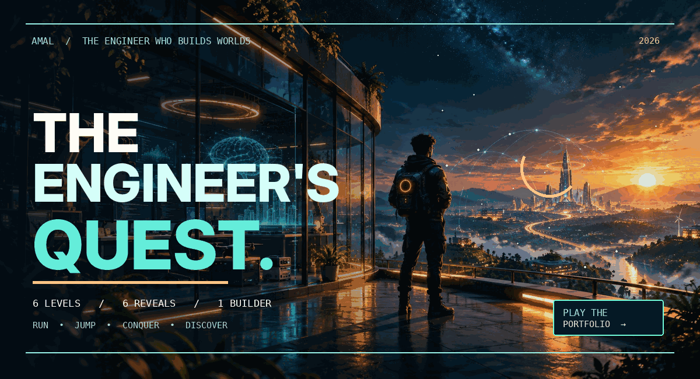
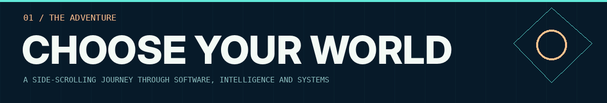
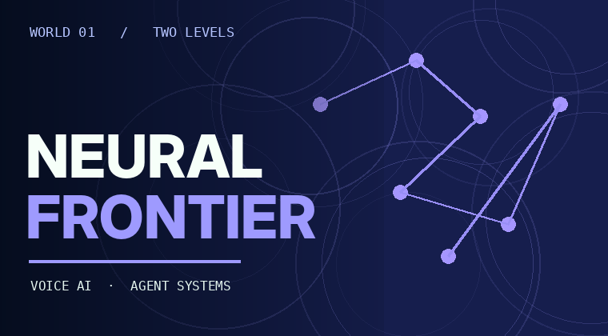
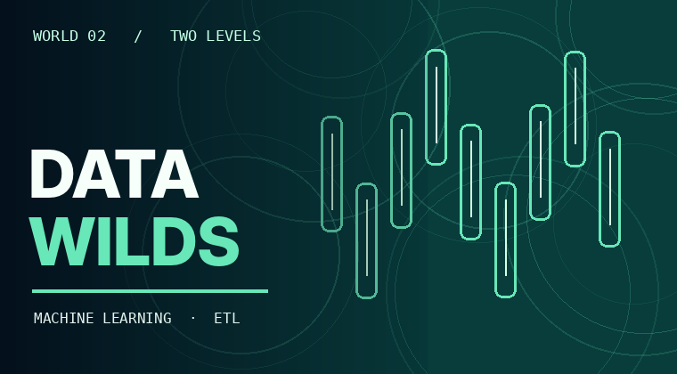
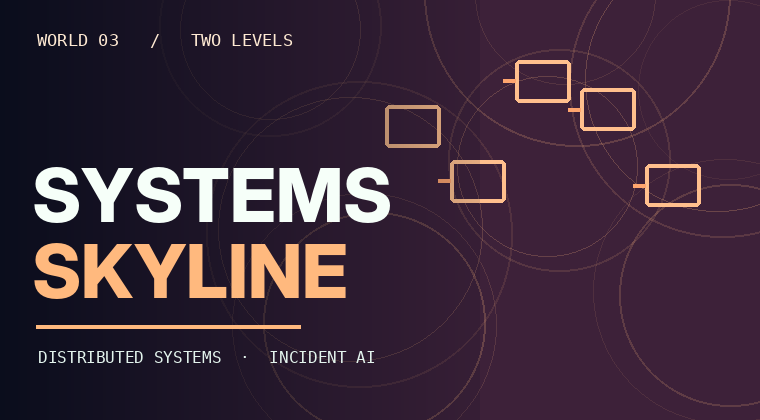
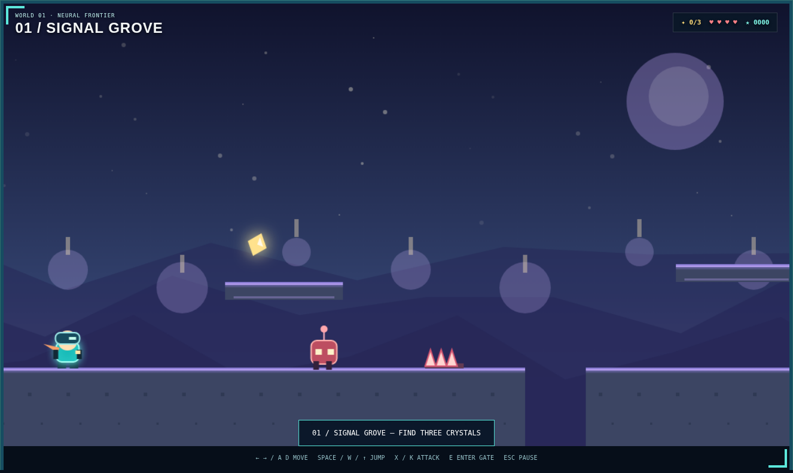
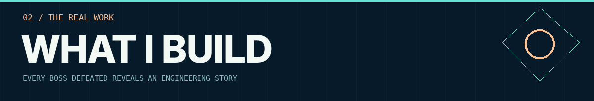
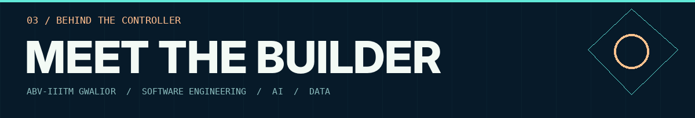
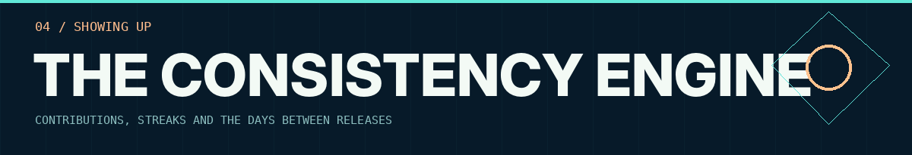
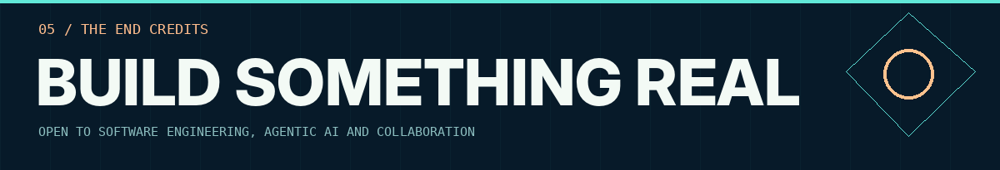

<!-- AMALVERSE // THE ENGINEER'S QUEST // cinematic GitHub profile edition.
     GitHub strips custom styles/scripts. Typography is designed into local artwork;
     searchable project descriptions and accessible link text remain Markdown.
     Game is served from /docs using GitHub Pages, not inside this README. -->

<a href="https://amalbajpayee09.github.io/AmalBajpayee09/" title="Play AMALVERSE: The Engineer's Quest">
  <picture>
    <source media="(prefers-reduced-motion: reduce)" srcset="assets/hero-vision.jpg" />
    
  </picture>
</a>

### **HI, I'M AMAL BAJPAYEE. I TURN IDEAS INTO ENGINEERED EXPERIENCES.**

**`SOFTWARE ENGINEERING`** &nbsp; ✦ &nbsp; **`AGENTIC AI`** &nbsp; ✦ &nbsp; **`DATA SYSTEMS`** &nbsp; ✦ &nbsp; **`PRODUCT THINKING`**

**A real browser platformer, not a GIF pretending to be a game.**

*Run. Jump. Fight robots. Collect code crystals. Cross hazards. Defeat the final sentinel. Unlock the story.*

NO LOGIN • NO INSTALL • KEYBOARD + TOUCH CONTROLS • A RECRUITER-FRIENDLY SKIP OPTION

---

The adventure is built around six distinct levels. Each one reveals a project from a different part of my engineering journey. **The full project archive is public too**—visitors who want to hire rather than play can jump straight to the details.

ACTUAL GAMEPLAY • A / D or ← / → MOVE • SPACE JUMP • X ATTACK • E OPEN GATE • ESC PAUSE

---

### **SIX MISSIONS. SIX REAL TECHNICAL STORIES.**

<b>🎙️ LEVEL 01 — BHARATVOICE AI</b> | Multilingual voice intelligence

A real-time voice AI platform for Hindi, English and Hinglish browser/phone conversations. It brings together speech-to-text, an LLM, text-to-speech and retrieval-driven business knowledge.

`Python` · `FastAPI` · `WebSockets` · `Groq` · `Deepgram` · `Piper` · `RAG` · `ChromaDB`

<b>🧠 LEVEL 02 — AI HIRING COPILOT</b> | Agentic recruitment

Resume parsing, candidate/job matching, skill-gap analysis and generated interview questions through LangGraph workflows, FAISS semantic search and a Python backend.

`Python` · `LangGraph` · `RAG` · `FAISS` · `FastAPI` · `PostgreSQL` · `Redis`

<b>📈 LEVEL 03 — PROSPECTIQ</b> | Explainable machine learning

Prospect scoring through XGBoost, Random Forest and Logistic Regression, with feature engineering, probability calibration, evaluation and SHAP model explainability. Also explores RAG-assisted intelligence workflows.

`Scikit-learn` · `XGBoost` · `SHAP` · `Python` · `LangGraph` · `MLflow`

<b>🏢 LEVEL 04 — LEDGERFLOW</b> | Enterprise finance data operations

Full-stack operational workflows, role-based permissions and audit trails; financial data validation and reconciliation using Databricks/PySpark alongside a FastAPI/React application.

`React` · `FastAPI` · `SQL` · `Databricks` · `PySpark` · `SharePoint`

<b>⚙️ LEVEL 05 — TRANSACTX</b> | Distributed transactions

Java/Spring Boot and Kafka services exploring the transactional outbox, idempotent processing, distributed locking, circuit breakers and operational visibility.

`Java` · `Spring Boot` · `Kafka` · `PostgreSQL` · `Redis` · `Grafana`

<b>🚨 LEVEL 06 — CLOUDOPS AI</b> | Real-time incident intelligence

Incident dashboards, real-time updates, authenticated workflows, and LLM-assisted investigation with human approval for proposed remediation.

`React` · `Node.js` · `Express` · `Redis` · `Socket.IO` · `JWT` · `Docker`

**`AI + FULL STACK + BACKEND + DATA + DISTRIBUTED SYSTEMS`**

[**PLAY TO DISCOVER THE PROJECTS**](https://amalbajpayee09.github.io/AmalBajpayee09/) &nbsp; · &nbsp; [**BROWSE PUBLIC REPOSITORIES**](https://github.com/AmalBajpayee09?tab=repositories)

---

I'm an **Integrated B.Tech. + M.Tech. Information Technology student at ABV-IIITM Gwalior (2022–2027)**. I enjoy building across the stack: software people can use, reliable APIs, intelligent agents, machine learning pipelines, and tools that turn raw data into decisions.

At **Lord-Tech Datus Solutions**, I contributed as a **Core Technical Member – AI & Smart City** to the **TIIC-funded NirmalGwalior Smart City project** (₹2,00,000 innovation funding), working with **Python, YOLOv8, OpenCV, MiDaS, FastAPI, PostgreSQL/PostGIS and React**. As a **Data Analytics Intern**, I worked with **Python/Pandas datasets, EDA and Power BI reporting**.

**My current engineering interests:** `System Design` · `Reliable Backends` · `AI Agents` · `Machine Learning` · `Data Engineering` · `Developer Experience`

**LLMs** · **LangGraph** · **RAG** · **FAISS** · **Scikit-learn** · **XGBoost** · **PySpark** · **AWS** · **GitHub Actions**

---

**THE WORK ISN'T IN ONE COMMIT. IT'S IN SHOWING UP AGAIN.**

 

  

<picture>
  <source media="(prefers-color-scheme: dark)" srcset="https://raw.githubusercontent.com/AmalBajpayee09/AmalBajpayee09/output/github-contribution-grid-snake-dark.svg" />
  <source media="(prefers-color-scheme: light)" srcset="https://raw.githubusercontent.com/AmalBajpayee09/AmalBajpayee09/output/github-contribution-grid-snake.svg" />
  
</picture>

My native contribution heatmap, commit history and existing snake workflow remain unchanged.

[**SEE THE NATIVE GITHUB CONTRIBUTION CALENDAR**](https://github.com/AmalBajpayee09?tab=overview)

---

### **LET'S MAKE SOMETHING WORTH BUILDING.**

If you're working on reliable software, AI agents, ML/data products or interesting open source, I'd love to hear about it.

[**🎮 PLAY THE QUEST**](https://amalbajpayee09.github.io/AmalBajpayee09/) &nbsp; · &nbsp; [**🌐 PORTFOLIO**](https://abajpayee33.vercel.app/) &nbsp; · &nbsp; [**🔗 LINKEDIN**](https://www.linkedin.com/in/abajpai09/) &nbsp; · &nbsp; [**✉️ EMAIL**](mailto:amalbajpayee09@gmail.com)

*Great engineering is more than an impressive demo. It's something people can actually use.*

