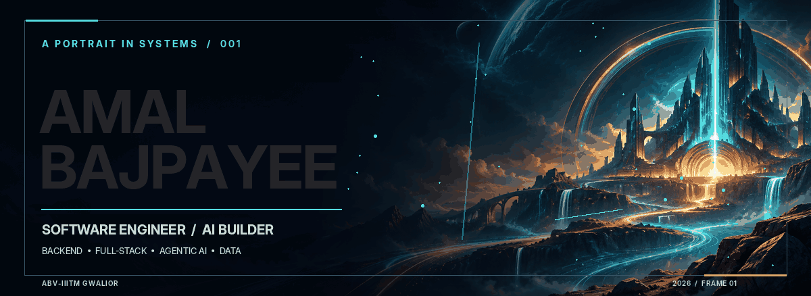
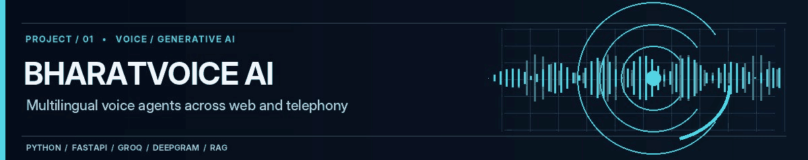
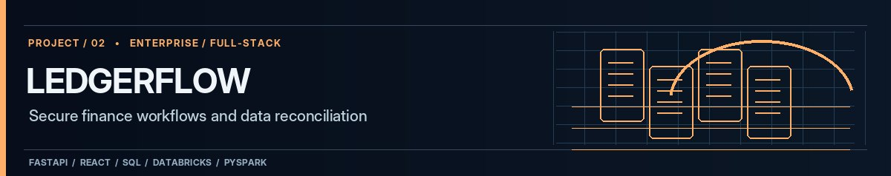
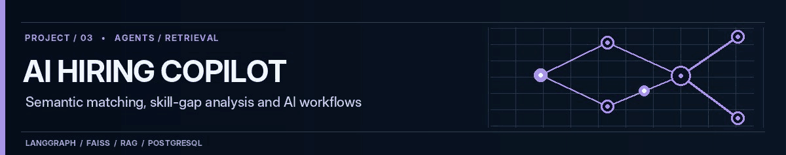
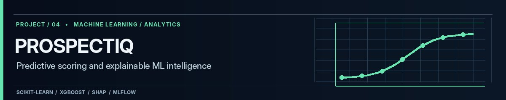
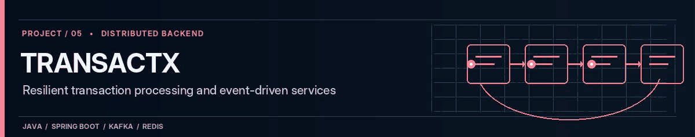
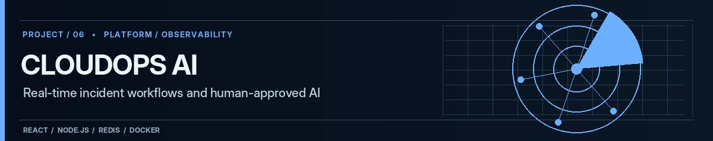
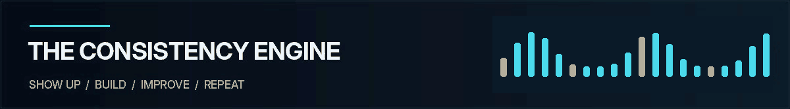
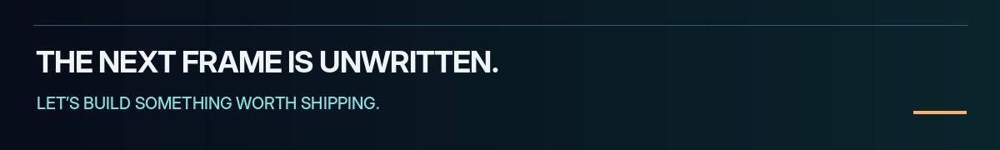

<!-- AMAL BAJPAYEE • DIRECTOR'S CUT / GitHub-compatible animated profile -->

 

  

Gwalior, India &nbsp; · &nbsp; Integrated B.Tech. + M.Tech., Information Technology &nbsp; · &nbsp; ABV-IIITM Gwalior

 

## 01 — The engineer behind the systems

I’m **Amal Bajpayee**. I design and build across **software engineering, backend platforms, full-stack products, agentic AI and data intelligence**. I like the intersection where difficult engineering problems become tools that people can actually use.

At **Lord-Tech Datus Solutions**, I contributed to the **TIIC-funded NirmalGwalior Smart City initiative**, working on **computer vision with YOLOv8 and MiDaS** and integrating the outputs with **FastAPI, PostgreSQL/PostGIS and React**. I have also worked with real-world datasets, Python analytics and Power BI reporting.

**My approach:** understand the problem → design the system → build the core → test the edges → improve what matters.

 

## 02 — Selected work

Six builds. Six different engineering problems. One constant: solve the real problem.

 

[**Browse public code & technical experiments**](https://github.com/AmalBajpayee09?tab=repositories) &nbsp; · &nbsp; [**Explore the portfolio**](https://abajpayee33.vercel.app/)

Project artwork is an editorial overview, not a screenshot or claim of public deployment. Some individual repositories may be private or works in progress.

 

## 03 — Engineering disciplines

**SOFTWARE & SYSTEMS** &nbsp; · &nbsp; Python · Java · Go · C++ · JavaScript · TypeScript · FastAPI · Spring Boot · Node.js · React · Next.js

**DATA & INFRASTRUCTURE** &nbsp; · &nbsp; PostgreSQL · Redis · SQL · Kafka · Databricks · PySpark · Docker · Kubernetes · AWS

**APPLIED INTELLIGENCE** &nbsp; · &nbsp; Machine Learning · Scikit-learn · XGBoost · OpenCV · RAG · LangGraph · FAISS · LLM integrations

**ENGINEERING PRACTICE** &nbsp; · &nbsp; Git · CI/CD · Testing · REST APIs · Authentication · Observability · Distributed Systems

 

## 04 — Proof beyond the screen

**Smart City / Applied AI** — Computer vision, depth estimation, waste-monitoring pipelines, location-aware APIs and dashboards on a **₹2,00,000 TIIC-funded initiative** at ABV-IIITM Gwalior.

**Analytics / Practical data** — Python and Pandas data cleaning, validation, exploratory analysis and Power BI dashboards built during a data analytics internship.

**Still exploring** — Distributed systems, scalable cloud architectures, model evaluation, agent reliability and MLOps.

 

## 05 — Consistency is a system

 

 

  

<a href="https://github.com/AmalBajpayee09?tab=overview&from=2026-01-01&to=2026-12-31"><strong>VIEW THE NATIVE GITHUB CONTRIBUTION CALENDAR</strong></a>

  

<picture>
  <source media="(prefers-color-scheme: dark)" srcset="https://raw.githubusercontent.com/AmalBajpayee09/AmalBajpayee09/output/github-contribution-grid-snake-dark.svg" />
  <source media="(prefers-color-scheme: light)" srcset="https://raw.githubusercontent.com/AmalBajpayee09/AmalBajpayee09/output/github-contribution-grid-snake.svg" />
  
</picture>

Activity data comes from GitHub / third-party widgets. The snake appears when the existing GitHub Actions workflow has successfully published its output.

 

## 06 — The next chapter

 

I’m open to thoughtful conversations about **software engineering, AI, infrastructure, research-driven prototypes and open source**.

 

[**Portfolio**](https://abajpayee33.vercel.app/) &nbsp; · &nbsp; [**GitHub**](https://github.com/AmalBajpayee09) &nbsp; · &nbsp; [**LinkedIn**](https://www.linkedin.com/in/abajpai09/) &nbsp; · &nbsp; [**Email**](mailto:amalbajpayee09@gmail.com)

 

Original cinematic art and motion graphics created for this profile. Readability and real engineering work come first.

